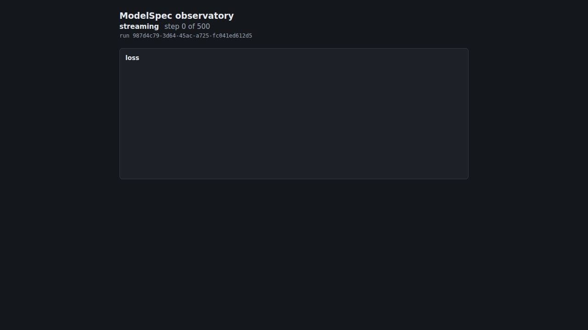

# R-00: observatory UI round

Date 2026-10-25, HEAD `c1b949ba5aa7853c961501cc6c0df84c30459b9f` with uncommitted changes outside `ui/ux/rounds/` (dirty), `ui/dist` SHA-256 `3ad02510cfb02f1ef6163967c929b18733c9ff3dc3649269506565d995734589`. Scenarios: `linear-regression` (anchor), `two-layer-relu` (anchor), `accuracy` (rotating).

## Caveats

1. Hermetic and synthetic: no people, no questionnaire, no L4, L5 or L6. Time is counted in events, because the recordings carry no timestamps: the layout replays send one event at a time, the live replay of the screen-only user one every 40 ms.
2. Gate 1 allows the page's own vertical scroll (the story's acceptance); skill § 4 allows it only for docs sites. Under the skill's gate the scenarios whose tasks need a key press (actions_per_fix.max above 0: linear-regression, two-layer-relu) would fail at both gating viewports, because that key press scrolls the page.
3. layout_shift.per_100_events divides a replay's shift sum by its event count, so the same shift weighs less the longer the run: the values are not comparable across scenarios, and where the value is below the tolerance 0.01 (linear-regression, two-layer-relu) an improvement to 0 is not reported and a regression of up to 0.01 passes.
4. screen_only.steers carries no information: the app has no guidance cue, and a steer (Home from the bottom) fires only when an answer is missing from the page.
5. reading_load gets worse when UXF-001 is fixed, because more of the parameter panels come into view; that fix will need a decision id for the ratchet.
6. The screen-only user runs in the light theme only, and the failed end state is replayed on the rotating card only (round.json failed_end).
7. Every page runs under the injected font stack "DejaVu Sans" and "DejaVu Sans Mono", so that this machine and the CI runner measure the same words; a reader with the app's own system font sees other line breaks.
8. The rule that a baseline is never made worse than main's did not run: origin/main carries no ui/ux/baseline.json (the first landing).

## Metrics

Measured, with the baseline in parentheses. Lower is better.

| key | linear-regression | two-layer-relu | accuracy |
|---|---:|---:|---:|
| actions_per_fix.max | 1 (1) | 1 (1) | 0 (0) |
| actions_per_fix.median | 0 (0) | 0 (0) | 0 (0) |
| glance_cost.median | 1 (1) | 1 (1) | 1 (1) |
| glance_cost.p95 | 3 (3) | 3 (3) | 2 (2) |
| layout_shift.per_100_events | 0.000778 (0.000778) | 0.002008 (0.002008) | 0.019456 (0.019456) |
| reading_load.max | 33 (33) | 33 (33) | 25 (25) |
| reading_load.median | 30 (30) | 30 (30) | 25 (25) |
| screen_only.actions | 1 (1) | 1 (1) | 0 (0) |
| screen_only.looks | 5 (5) | 5 (5) | 4 (4) |
| screen_only.steers | 0 (0) | 0 (0) | 0 (0) |
| screen_only.time_to_act_steps.max | 0 (0) | 0 (0) | 0 (0) |

Last round: none; this is the first.

## Bars (hard gates)

- gate 1, no scroll: no scrollable element and no horizontal page scroll at 1366x768 and 1280x720 in light and dark after every replayed event (the page's own vertical scroll is allowed)
- gate 2, always visible: the run header and its state, the loss chart, and with parameters the histogram step picker and the first parameter name wholly in view after every event
- gate 3, unmissable completion: completion_miss = 0 and false_complete = 0 (the failed end state is checked on the rotating card ending in RunFailed, recorded under failed_end)
- gate 4, screen-only user: every task read equal to the truth, each in at most 2 actions, and every live reading equal to the truth at the step it shows
- gate 5, accessibility: axe-core 0 serious or critical violations (wcag2a, wcag2aa, wcag21a, wcag21aa, wcag22aa) at every key moment in both themes; every focusable reached by Tab with a focus indicator; no animation under reduced motion after any event
- gate 6, cue truth: not applicable, the app has no guidance cue

| replay | violations | completion_miss | false_complete | axe serious+critical |
|---|---:|---:|---:|---:|
| accuracy 1280x720 dark | 0 | 0 | 0 | 0 |
| accuracy 1280x720 light | 0 | 0 | 0 | 0 |
| accuracy 1366x768 dark | 0 | 0 | 0 | 0 |
| accuracy 1366x768 light | 0 | 0 | 0 | 0 |
| accuracy-failed 1366x768 dark (failed end, not ratcheted) | 0 | 0 | 0 | 0 |
| accuracy-failed 1366x768 light (failed end, not ratcheted) | 0 | 0 | 0 | 0 |
| linear-regression 1280x720 dark | 0 | 0 | 0 | 0 |
| linear-regression 1280x720 light | 0 | 0 | 0 | 0 |
| linear-regression 1366x768 dark | 0 | 0 | 0 | 0 |
| linear-regression 1366x768 light | 0 | 0 | 0 | 0 |
| two-layer-relu 1280x720 dark | 0 | 0 | 0 | 0 |
| two-layer-relu 1280x720 light | 0 | 0 | 0 | 0 |
| two-layer-relu 1366x768 dark | 0 | 0 | 0 | 0 |
| two-layer-relu 1366x768 light | 0 | 0 | 0 | 0 |

## Screen-only user

| scenario | viewport | task | read | correct | actions | looks | steers | glance |
|---|---|---|---|---|---:|---:|---:|---:|
| accuracy | 1280x720 | last-loss | `loss step 20: 0.0952381` | yes | 0 | 1 | 0 | 1 |
| accuracy | 1280x720 | last-step | `loss step 20: 0.0952381` | yes | 0 | 1 | 0 | 1 |
| accuracy | 1280x720 | last-accuracy | `accuracy step 20: 0.85` | yes | 0 | 1 | 0 | 2 |
| accuracy | 1280x720 | end-state | `finished step 20 of 21` | yes | 0 | 1 | 0 | 2 |
| accuracy | 1366x768 | last-loss | `loss step 20: 0.0952381` | yes | 0 | 1 | 0 | 1 |
| accuracy | 1366x768 | last-step | `loss step 20: 0.0952381` | yes | 0 | 1 | 0 | 1 |
| accuracy | 1366x768 | last-accuracy | `accuracy step 20: 0.85` | yes | 0 | 1 | 0 | 2 |
| accuracy | 1366x768 | end-state | `finished step 20 of 21` | yes | 0 | 1 | 0 | 2 |
| linear-regression | 1280x720 | last-loss | `loss step 500: 5.572e-11` | yes | 0 | 1 | 0 | 1 |
| linear-regression | 1280x720 | last-step | `loss step 500: 5.572e-11` | yes | 0 | 1 | 0 | 1 |
| linear-regression | 1280x720 | first-parameter-gradient | `LinearReg.w gradient norm step 400: 3.041e-5` | yes | 1 | 2 | 0 | 3 |
| linear-regression | 1280x720 | end-state | `finished step 500 of 500` | yes | 0 | 1 | 0 | 2 |
| linear-regression | 1366x768 | last-loss | `loss step 500: 5.572e-11` | yes | 0 | 1 | 0 | 1 |
| linear-regression | 1366x768 | last-step | `loss step 500: 5.572e-11` | yes | 0 | 1 | 0 | 1 |
| linear-regression | 1366x768 | first-parameter-gradient | `LinearReg.w gradient norm step 400: 3.041e-5` | yes | 1 | 2 | 0 | 3 |
| linear-regression | 1366x768 | end-state | `finished step 500 of 500` | yes | 0 | 1 | 0 | 2 |
| two-layer-relu | 1280x720 | last-loss | `loss step 200: 0.0184982` | yes | 0 | 1 | 0 | 1 |
| two-layer-relu | 1280x720 | last-step | `loss step 200: 0.0184982` | yes | 0 | 1 | 0 | 1 |
| two-layer-relu | 1280x720 | first-parameter-gradient | `TwoLayer.w1 gradient norm step 100: 0.0591128` | yes | 1 | 2 | 0 | 3 |
| two-layer-relu | 1280x720 | end-state | `finished step 200 of 200` | yes | 0 | 1 | 0 | 2 |
| two-layer-relu | 1366x768 | last-loss | `loss step 200: 0.0184982` | yes | 0 | 1 | 0 | 1 |
| two-layer-relu | 1366x768 | last-step | `loss step 200: 0.0184982` | yes | 0 | 1 | 0 | 1 |
| two-layer-relu | 1366x768 | first-parameter-gradient | `TwoLayer.w1 gradient norm step 100: 0.0591128` | yes | 1 | 2 | 0 | 3 |
| two-layer-relu | 1366x768 | end-state | `finished step 200 of 200` | yes | 0 | 1 | 0 | 2 |

## Worst moments

- linear-regression: the highest reading load, 33 words in view at first-step (1366x768 dark). 
- linear-regression: the largest layout shift, 0.00353 at event 0 (RunStarted) (1280x720 dark; section.charts in page). 
- linear-regression: the costliest task, first-parameter-gradient: 1 actions (PageDown), glance 3 at the start. 
- two-layer-relu: the highest reading load, 33 words in view at first-step (1366x768 dark). 
- two-layer-relu: the largest layout shift, 0.00353 at event 0 (RunStarted) (1280x720 dark; section.charts in page). 
- two-layer-relu: the costliest task, first-parameter-gradient: 1 actions (PageDown), glance 3 at the start. 
- accuracy: the highest reading load, 25 words in view at first-step (1366x768 dark). 
- accuracy: the largest layout shift, 0.00353 at event 0 (RunStarted) (1280x720 dark; section.charts in page). 

## Contact sheets

Every key moment in both themes, each frame 0.75 s after its moment, at the first gating viewport.

- linear-regression: 
- two-layer-relu: 
- accuracy: 

## Measured-only viewports

| scenario | viewport | theme | layout findings | reading_load.max |
|---|---|---|---|---:|
| accuracy | 1440x900 | dark | none | 25 |
| accuracy | 1440x900 | light | none | 25 |
| accuracy | 1920x1080 | dark | none | 25 |
| accuracy | 1920x1080 | light | none | 25 |
| accuracy | 390x844 | dark | none | 25 |
| accuracy | 390x844 | light | none | 25 |
| linear-regression | 1440x900 | dark | none | 40 |
| linear-regression | 1440x900 | light | none | 40 |
| linear-regression | 1920x1080 | dark | none | 43 |
| linear-regression | 1920x1080 | light | none | 43 |
| linear-regression | 390x844 | dark | none | 49 |
| linear-regression | 390x844 | light | none | 49 |
| two-layer-relu | 1440x900 | dark | none | 40 |
| two-layer-relu | 1440x900 | light | none | 40 |
| two-layer-relu | 1920x1080 | dark | none | 43 |
| two-layer-relu | 1920x1080 | light | none | 43 |
| two-layer-relu | 390x844 | dark | none | 49 |
| two-layer-relu | 390x844 | light | none | 49 |

## Findings

| id | title | class | severity | status | regression asset |
|---|---|---|---|---|---|
| UXF-001 | the parameter panels are out of view; a parameter's gradient norm takes a page down | layout | S3 | open | the ratchet keys glance_cost.p95 = 3 and actions_per_fix.max = 1 of linear-regression and two-layer-relu in baseline.json (ratchet.spec.ts); a fix lowers them and takes the new values in |
| UXF-002 | the charts shift down when the run id line appears | noise | S3 | open | layout_shift.per_minute of every scenario in baseline.json (ratchet.spec.ts); a fix lowers it and takes the new value in |
| UXF-003 | the run state is a plain paragraph, not a landmark or a live region | affordance | S3 | open | none yet; planned with its fix: the end-state task of tasks.json found by role status instead of paragraph |
| UXF-004 | a finished run reads "step 20 of 21" | input | S3 | open | the accuracy end-state task (scenarios/accuracy/tasks.json, read by screen-only.spec.ts) reads the state word and the progress "step 20 of 21" on screen and compares the step and the total with truth.json's last_step 20 and steps 21; a fix of the wording or a regression of either number fails gate 4 until the task follows it |
| UXF-005 | the last value of each chart is 13.5 px | copy | S3 | open | heuristic checklist line 15 for the L7 heuristic reviewer; none automated yet |
| UXF-006 | a chart with fewer than two points draws no mark, says nothing, and its step axis reads -1 to 1 | cue | S2 | open | none yet; planned: a Playwright assertion that every chart with one point draws a visible mark and labels its step axis with that step, and that a chart with none shows a sentence |
| UXF-007 | "step 0 of N" is shown before any step has completed | copy | S3 | open | none yet; planned: the started key moment's state line read by the screen-only user and compared with a truth of "no step completed" |
| UXF-008 | a gradient norm chart's step axis ends at its last gradient, so the charts of one parameter do not line up | layout | S3 | open | none yet; planned: a Playwright assertion that the norm charts of one parameter share the step range of the loss chart |
| UXF-009 | a histogram's bin counts show only on pointer hover | affordance | S3 | open | none yet; planned: a screen-only task that reads the count of the tallest bin |
| UXF-010 | the loss chart's linear scale flattens most of the run onto its floor | cue | S3 | open | heuristic checklist line 3 for the L7 heuristic reviewer; none automated yet |
| UXF-011 | at 390 px wide the chart axis labels shrink to about 6 px | layout | S3 | open | heuristic checklist line 15 for the L7 heuristic reviewer; none automated yet |

## Ratchet

No value worse than, better than or missing from the baseline.

## Definitions

- reading_load: words of rendered text nodes whose box is at least half inside the viewport at a key moment (connecting, started, first-step, middle-step, last-step, end), over both gating viewports and themes
- layout_shift.per_100_events: the Layout Instability API's shift sum over a gating replay that sends one event at a time, per 100 replayed events; the worst replay
- actions_per_fix: the key presses the screen-only user needs for one task from the top of the page at the end state (a fix: bringing an answer into view); every task at both gating viewports
- glance_cost: the glance level of every task the page can answer at every key moment, both gating viewports: 1 in the loss chart (the primary card), 2 elsewhere in view, 3 not in view; the end-state task is answerable only once the state reads finished or failed
- screen_only.actions, looks, steers: the sums over one viewport's tasks (key presses; screens read, waits for the end state included; reversals of course, Home from the bottom), the worse viewport
- screen_only.time_to_act_steps.max: with the stream running at one event every 40 ms while the user reads, the steps sent at least 250 ms before a reading of a live task began minus the steps up to the one the screen shows; the most over every reading, task and gating viewport
- the screen-only user reads a value only when its own text is in view, uncovered and not transparent

## Not run

- L0 engine scenarios and gate 6: the app has no guidance cue
- L4 keyed replay, L5 discoverability probe: paid, operator-only
- L6 recorded live rounds, L8 real-user sessions, the questionnaire: no people in this round
- L7 heuristic and report review agents: started by the coordinator after this round command
