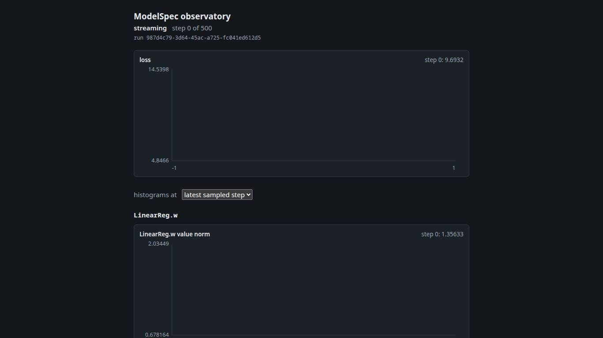
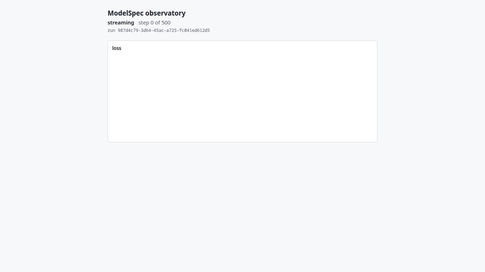
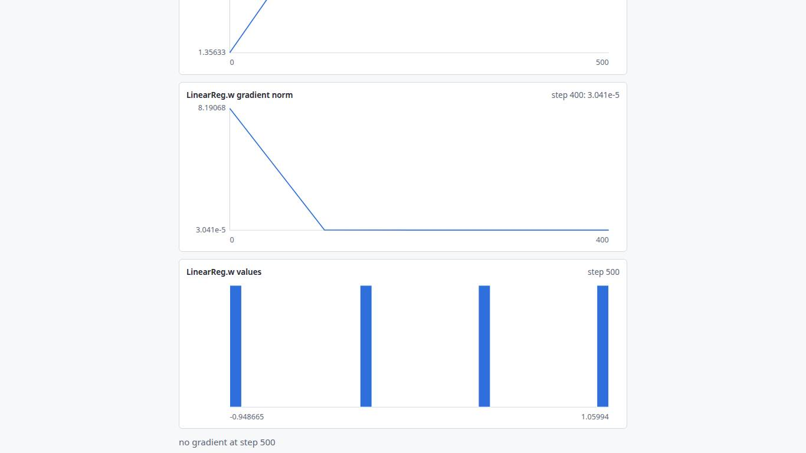
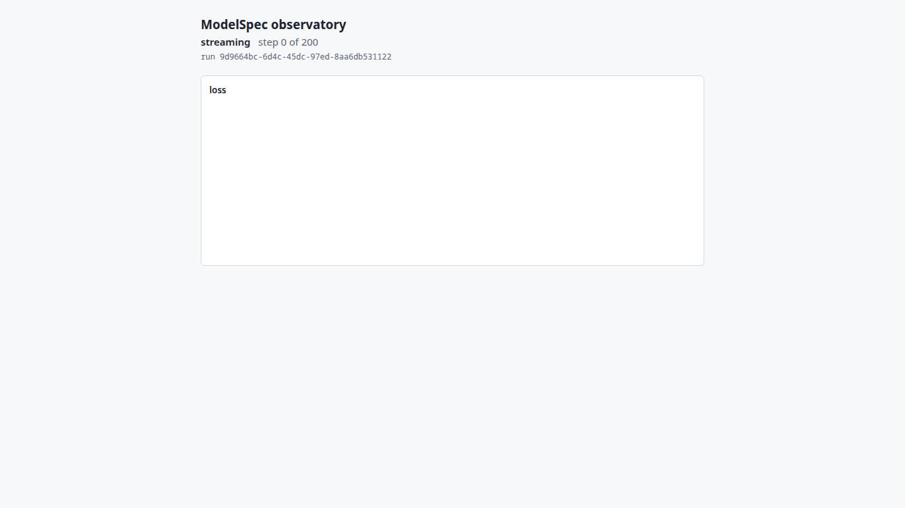
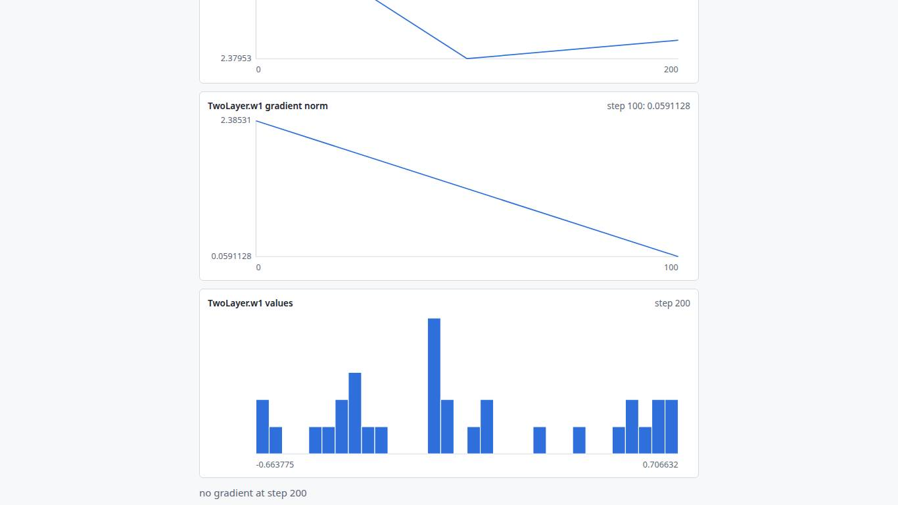
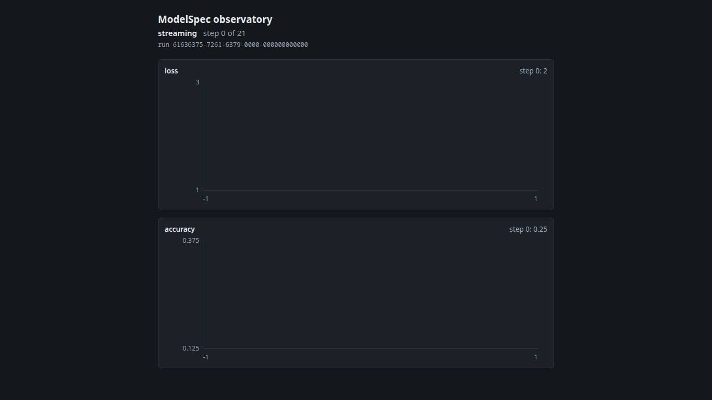
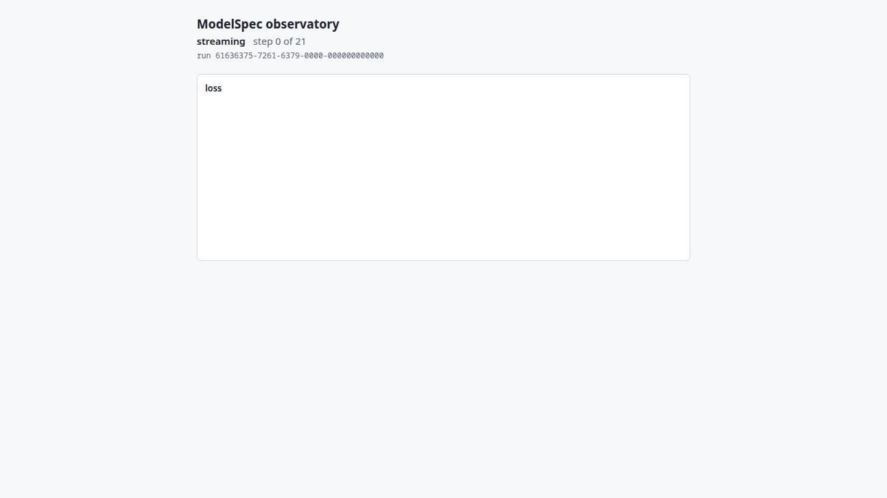
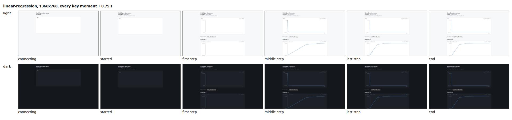
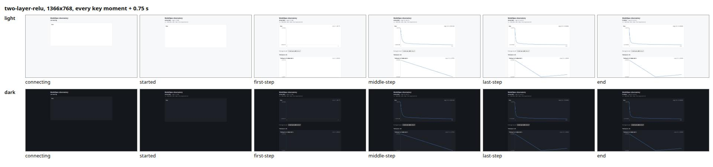
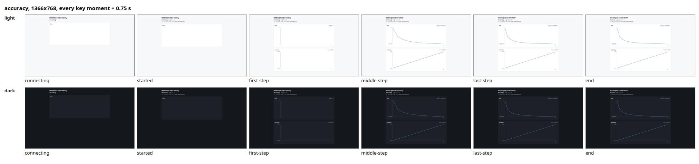

# R-00: observatory UI round

Date 2026-10-25, commit `2d83128`. Scenarios: `linear-regression` (anchor), `two-layer-relu` (anchor), `accuracy` (rotating).

## Metrics

Measured, with the baseline in parentheses. Lower is better.

| key | linear-regression | two-layer-relu | accuracy |
|---|---:|---:|---:|
| actions_per_fix.max | 1 (1) | 1 (1) | 0 (0) |
| actions_per_fix.median | 0 (0) | 0 (0) | 0 (0) |
| glance_cost.median | 2 (2) | 2 (2) | 2 (2) |
| glance_cost.p95 | 3 (3) | 3 (3) | 2 (2) |
| layout_shift.per_minute | 0.005405 (0.005405) | 0.013839 (0.013839) | 0.13157 (0.13157) |
| reading_load.max | 31 (31) | 31 (31) | 25 (25) |
| reading_load.median | 30 (30) | 30 (30) | 25 (25) |
| screen_only.actions | 1 (1) | 1 (1) | 0 (0) |
| screen_only.looks | 5 (5) | 5 (5) | 4 (4) |
| screen_only.steers | 0 (0) | 0 (0) | 0 (0) |
| screen_only.time_to_act_steps.max | 0 (0) | 0 (0) | 0 (0) |

Last round: none; this is the first.

## Bars (hard gates)

- gate 1, no scroll: no scrollable element and no horizontal page scroll at 1366x768 and 1280x720 in light and dark after every replayed event (the page's own vertical scroll is allowed)
- gate 2, always visible: the run header and its state, the loss chart, and with parameters the histogram step picker and the first parameter name wholly in view after every event
- gate 3, unmissable completion: completion_miss = 0 and false_complete = 0 (the failed end state is checked on the rotating card ending in RunFailed)
- gate 4, screen-only user: every task read equal to the truth, each in at most 2 actions
- gate 5, accessibility: axe-core 0 serious or critical violations (wcag2a, wcag2aa, wcag21a, wcag21aa, wcag22aa) at every key moment in both themes; every focusable reached by Tab with a focus indicator; no animation under reduced motion
- gate 6, cue truth: not applicable, the app has no guidance cue

| replay | violations | completion_miss | false_complete | axe serious+critical |
|---|---:|---:|---:|---:|
| accuracy 1280x720 dark | 0 | 0 | 0 | 0 |
| accuracy 1280x720 light | 0 | 0 | 0 | 0 |
| accuracy 1366x768 dark | 0 | 0 | 0 | 0 |
| accuracy 1366x768 light | 0 | 0 | 0 | 0 |
| linear-regression 1280x720 dark | 0 | 0 | 0 | 0 |
| linear-regression 1280x720 light | 0 | 0 | 0 | 0 |
| linear-regression 1366x768 dark | 0 | 0 | 0 | 0 |
| linear-regression 1366x768 light | 0 | 0 | 0 | 0 |
| two-layer-relu 1280x720 dark | 0 | 0 | 0 | 0 |
| two-layer-relu 1280x720 light | 0 | 0 | 0 | 0 |
| two-layer-relu 1366x768 dark | 0 | 0 | 0 | 0 |
| two-layer-relu 1366x768 light | 0 | 0 | 0 | 0 |

## Screen-only user

| scenario | viewport | task | read | correct | actions | looks | steers | glance |
|---|---|---|---|---|---:|---:|---:|---:|
| accuracy | 1280x720 | last-loss | `loss step 20: 0.0952381` | yes | 0 | 1 | 0 | 1 |
| accuracy | 1280x720 | last-step | `loss step 20: 0.0952381` | yes | 0 | 1 | 0 | 1 |
| accuracy | 1280x720 | last-accuracy | `accuracy step 20: 0.85` | yes | 0 | 1 | 0 | 2 |
| accuracy | 1280x720 | end-state | `finished step 20 of 21` | yes | 0 | 1 | 0 | 2 |
| accuracy | 1366x768 | last-loss | `loss step 20: 0.0952381` | yes | 0 | 1 | 0 | 1 |
| accuracy | 1366x768 | last-step | `loss step 20: 0.0952381` | yes | 0 | 1 | 0 | 1 |
| accuracy | 1366x768 | last-accuracy | `accuracy step 20: 0.85` | yes | 0 | 1 | 0 | 2 |
| accuracy | 1366x768 | end-state | `finished step 20 of 21` | yes | 0 | 1 | 0 | 2 |
| linear-regression | 1280x720 | last-loss | `loss step 500: 5.572e-11` | yes | 0 | 1 | 0 | 1 |
| linear-regression | 1280x720 | last-step | `loss step 500: 5.572e-11` | yes | 0 | 1 | 0 | 1 |
| linear-regression | 1280x720 | first-parameter-gradient | `LinearReg.w gradient norm step 400: 3.041e-5` | yes | 1 | 2 | 0 | 3 |
| linear-regression | 1280x720 | end-state | `finished step 500 of 500` | yes | 0 | 1 | 0 | 2 |
| linear-regression | 1366x768 | last-loss | `loss step 500: 5.572e-11` | yes | 0 | 1 | 0 | 1 |
| linear-regression | 1366x768 | last-step | `loss step 500: 5.572e-11` | yes | 0 | 1 | 0 | 1 |
| linear-regression | 1366x768 | first-parameter-gradient | `LinearReg.w gradient norm step 400: 3.041e-5` | yes | 1 | 2 | 0 | 3 |
| linear-regression | 1366x768 | end-state | `finished step 500 of 500` | yes | 0 | 1 | 0 | 2 |
| two-layer-relu | 1280x720 | last-loss | `loss step 200: 0.0184982` | yes | 0 | 1 | 0 | 1 |
| two-layer-relu | 1280x720 | last-step | `loss step 200: 0.0184982` | yes | 0 | 1 | 0 | 1 |
| two-layer-relu | 1280x720 | first-parameter-gradient | `TwoLayer.w1 gradient norm step 100: 0.0591128` | yes | 1 | 2 | 0 | 3 |
| two-layer-relu | 1280x720 | end-state | `finished step 200 of 200` | yes | 0 | 1 | 0 | 2 |
| two-layer-relu | 1366x768 | last-loss | `loss step 200: 0.0184982` | yes | 0 | 1 | 0 | 1 |
| two-layer-relu | 1366x768 | last-step | `loss step 200: 0.0184982` | yes | 0 | 1 | 0 | 1 |
| two-layer-relu | 1366x768 | first-parameter-gradient | `TwoLayer.w1 gradient norm step 100: 0.0591128` | yes | 1 | 2 | 0 | 3 |
| two-layer-relu | 1366x768 | end-state | `finished step 200 of 200` | yes | 0 | 1 | 0 | 2 |

## Worst moments

- linear-regression: the highest reading load, 31 words in view at first-step (1366x768 dark). 
- linear-regression: the largest layout shift, 0.00344 at event 0 (RunStarted) (section.charts in page). 
- linear-regression: the costliest task, first-parameter-gradient: 1 actions (PageDown), glance 3 at the start. 
- two-layer-relu: the highest reading load, 31 words in view at first-step (1366x768 dark). 
- two-layer-relu: the largest layout shift, 0.00344 at event 0 (RunStarted) (section.charts in page). 
- two-layer-relu: the costliest task, first-parameter-gradient: 1 actions (PageDown), glance 3 at the start. 
- accuracy: the highest reading load, 25 words in view at first-step (1366x768 dark). 
- accuracy: the largest layout shift, 0.00344 at event 0 (RunStarted) (section.charts in page). 

## Contact sheets

Every key moment in both themes, each frame 0.75 s after its moment, at the first gating viewport.

- linear-regression: 
- two-layer-relu: 
- accuracy: 

## Measured-only viewports

| scenario | viewport | theme | layout findings | reading_load.max |
|---|---|---|---|---:|
| accuracy | 1440x900 | dark | none | 25 |
| accuracy | 1440x900 | light | none | 25 |
| accuracy | 1920x1080 | dark | none | 25 |
| accuracy | 1920x1080 | light | none | 25 |
| accuracy | 390x844 | dark | none | 25 |
| accuracy | 390x844 | light | none | 25 |
| linear-regression | 1440x900 | dark | none | 40 |
| linear-regression | 1440x900 | light | none | 40 |
| linear-regression | 1920x1080 | dark | none | 43 |
| linear-regression | 1920x1080 | light | none | 43 |
| linear-regression | 390x844 | dark | none | 49 |
| linear-regression | 390x844 | light | none | 49 |
| two-layer-relu | 1440x900 | dark | none | 40 |
| two-layer-relu | 1440x900 | light | none | 40 |
| two-layer-relu | 1920x1080 | dark | none | 43 |
| two-layer-relu | 1920x1080 | light | none | 43 |
| two-layer-relu | 390x844 | dark | none | 49 |
| two-layer-relu | 390x844 | light | none | 49 |

## Findings

| id | title | class | severity | status | regression asset |
|---|---|---|---|---|---|
| UXF-001 | the parameter panels are out of view; a parameter's gradient norm takes a page down | layout | S3 | open | the ratchet keys glance_cost.p95 = 3 and actions_per_fix.max = 1 of linear-regression and two-layer-relu in baseline.json (ratchet.spec.ts); a fix lowers them and takes the new values in |
| UXF-002 | the charts shift down when the run id line appears | noise | S3 | open | layout_shift.per_minute of every scenario in baseline.json (ratchet.spec.ts); a fix lowers it and takes the new value in |
| UXF-003 | the run state is a plain paragraph, not a landmark or a live region | affordance | S3 | open | none yet; planned with its fix: the end-state task of tasks.json found by role status instead of paragraph |
| UXF-004 | a finished run reads "step 20 of 21" | input | S3 | open | the accuracy end-state task (screen-only.spec.ts) reads the state and its truth.json pins steps 21 and last_step 20 |
| UXF-005 | the last value of each chart is 13.5 px | copy | S3 | open | heuristic checklist line 15 for the L7 heuristic reviewer; none automated yet |

## Ratchet

No value worse than, better than or missing from the baseline.

## Definitions

- reading_load: words of rendered text nodes inside the viewport at a key moment (connecting, started, first-step, middle-step, last-step, end), over both gating viewports and themes
- layout_shift.per_minute: the Layout Instability API's shift sum over a replay, per minute of the compressed clock (600 events a minute); the worst replay
- actions_per_fix: the key presses the screen-only user needs for one task from the top of the page at the end state (a fix: bringing an answer into view); every task at both gating viewports
- glance_cost: the glance level of every task the page can answer at every key moment, both gating viewports: 1 in the loss chart (the primary card), 2 elsewhere in view, 3 not in view
- screen_only.actions, looks, steers: the sums over one viewport's tasks (key presses; screens read; reversals of course, Home from the bottom), the worse viewport
- screen_only.time_to_act_steps.max: the events the screen lagged behind the stream before a live task read the current value

## Not run

- L0 engine scenarios and gate 6: the app has no guidance cue
- L4 keyed replay, L5 discoverability probe: paid, operator-only
- L6 recorded live rounds, L8 real-user sessions: no people in R-00
- L7 heuristic and report review agents: started by the coordinator after this round command
